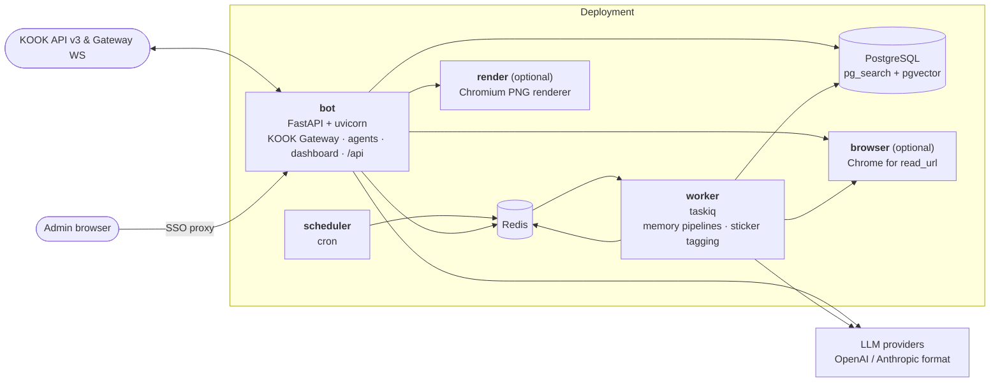

<div align="center">

# YggdrasilBot-KOOK

**An LLM agent that lives in KOOK servers, remembers across channels, and adapts its output for humans.**

Built as a pure-Python **FastAPI + self-developed KOOK API v3 & WebSocket Gateway** bot (zero NoneBot2 / OneBot / third-party KOOK SDK dependencies). It answers when addressed, verifies facts with real tools, reads links/files/images/cards, maintains channel-isolated live chats with guild-shared long-term memory, and can execute tasks in sandboxed Linux workspaces — all configured live from a synchronized React dashboard.


</div>

---

## Key Features

### Native KOOK Protocol (`yggdrasil/kook/`)
- **Self-developed KOOK REST API v3 (`httpx`) & WebSocket Gateway (`websockets` + `zlib`)**: Full `HELLO` / `PING` / `PONG` / `RESUME` / `RECONNECT` state machine, `EventSequencer` ordering/dedup, 429 rate-limit retries, `/asset/create` CDN uploads, and single-active Redis lease for zero-downtime rolling updates.
- **Native KOOK Reply (`quote`)**: Parses incoming `extra.quote` (preferring `id` over `rong_id`, lazily enriching missing attachments via `/message/view`), quotes trigger messages by default (`interaction.quote_reply = "always"`), and continues previous bot conversations when users reply to a bot answer.
- **Clickable Channel Mentions (`(chn)`)**: Converts incoming `(chn)<id>(chn)` tags via `mention_channel_part` + runtime channel table, and renders `#频道名` in outgoing KMarkdown/CardMessages into native clickable `(chn)<channel_id>(chn)` tags (including inside Chinese prose).
- **KOOK Bot-to-Bot Anti-Loop Guard**: Recognizes KOOK `author.bot=true` accounts and `[bot]` tags. Allows controlled bot-to-bot interaction (`allow_bot_triggers=True`) backed by three independent guards: per-bot cooldown (`bot_cooldown_s=20`, refreshed both on admission and after reply completion), consecutive bot-turn circuit breaker (`bot_max_consecutive_turns=2`, immediately reset when any human speaks), and a rolling window cap (`bot_max_per_window=3` per `bot_window_s=600`).

### 4-Level Configuration & Feature Inheritance
`global` → `guild (服务器)` → `category (分组)` → `channel (频道)`
- Sparse JSONB overrides merged cleanly at runtime (`merge_settings`).
- Tri-state `channels.enabled` (`true` / `false` / `null` inherit parent category) + guild master switch.
- Per-channel feature toggles (`features.chat`, `features.tldr`, `features.privacy_commands`, `features.sticker_collect`, `features.status_reactions`) and `memory.share_in_guild` isolation for private/admin channels.
- Unified 4-level `command_triggers` (`global` / `guild` / `category` / `channel` / `private`) — trigger prefixes (including default `ygg`) can be edited or overridden per scope in the dashboard.

### Channel-Isolated Chat + Guild-Shared Memory
- **Per-channel isolation**: Recent chat window, continuation sessions, message chunking, topic tracking, rate limits, sticker drops, and sandbox workspaces are isolated per `channel_id`.
- **Guild-shared long-term memory**: Hybrid search (`pg_search` BM25 + `pgvector` RRF), daily digests, glossary terms, user profiles/facts, and `#N` message lookups span all `share_in_guild=True` channels in the same `guild_id`, citing source channels as `[#频道名]`.

### Adaptive Human-Readable Output (`yggdrasil/delivery/`)
- Automatically chooses concise **KMarkdown (`type=9`)** for short replies and structured **KOOK CardMessage (`type=10`)** for multi-section answers, TL;DRs, images, and cited sources (with balanced fenced-code splitting and understated `context` metadata footers).

### KOOK Stickers
- Collects KOOK guild custom emojis (`kind="emoji"`, `(emj)name(emj)[id]`) and standalone GIF/small sticker images (`kind="image"`, sha256 dedup), with vision tagging, guild-shared usage popularity, and optional per-channel sticker drops.

---

## Architecture



---

## Quick Start (Local Development)

1. **Prerequisites**: Python 3.13+, `uv`, Node.js 22+, PostgreSQL with `pgvector` + ParadeDB `pg_search` (e.g. `paradedb/paradedb:0.26.0-pg18`), and Redis.
2. **Create a KOOK Bot**: In the [KOOK Developer Portal](https://developer.kookapp.cn), create an application, enable **Bot (WebSocket mode)**, copy the **Bot Token**, and invite the bot to your test server.
3. **Configure `.env`**:
   ```bash
   cp .env.example .env
   # Generate YGG_SECRET_KEY:
   uv run python -c "from cryptography.fernet import Fernet; print(Fernet.generate_key().decode())"
   # Fill in YGG_SECRET_KEY, YGG_SUPERUSERS=["<your-kook-user-id>"], and optionally YGG_KOOK_BOT_TOKEN
   ```
4. **Install dependencies & run migrations**:
   ```bash
   uv sync --all-groups
   uv run alembic upgrade head
   cd web && npm install && cd ..
   ```
5. **Start services**:
   ```bash
   # Terminal 1: FastAPI bot + Admin API (:8192)
   uv run yggdrasil bot
   # Terminal 2: Background worker (memory pipelines, sticker tagging)
   uv run yggdrasil worker
   # Terminal 3: Dashboard dev server
   cd web && npm run dev
   ```
6. **Connect & sync KOOK**: Open the dashboard (`http://localhost:5173`), go to **设置 → KOOK 连接** to save/verify your Bot Token, then open **频道** and click **从 KOOK 同步** to import your `服务器 ▸ 分组 ▸ 频道` hierarchy and enable the desired categories/channels.

---

## Development & Verification

```bash
# Lint, format, and type-check entire repo (matches CI, including tests and Python blocks in .md files)
uv run ruff format --check .
uv run ruff check .
uv run basedpyright

# Run unit tests (add YGG_TEST_DB=1 with test Postgres for @pytest.mark.db integration tests)
YGG_SECRET_KEY=AAAAAAAAAAAAAAAAAAAAAAAAAAAAAAAAAAAAAAAAAAA= uv run pytest -q

# Regenerate OpenAPI TypeScript SDK & build dashboard
YGG_SECRET_KEY=AAAAAAAAAAAAAAAAAAAAAAAAAAAAAAAAAAAAAAAAAAA= uv run python -m yggdrasil.admin.dump_openapi > web/openapi.json
cd web && npm run gen && npx tsc -b --noEmit && npm run build
```
